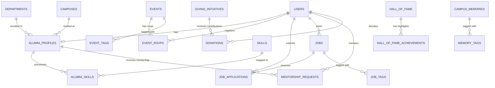

# MCU Alumni Portal Database Documentation

This directory contains the complete MySQL 8.0+ database schema and seed data for the **Makhanlal Chaturvedi National University of Journalism and Communication (MCU Bhopal) Alumni Portal**.

---

## 📁 Files in this Directory

| File | Description |
| :--- | :--- |
| [`schema.sql`](file:///d:/AlumniProject/database/schema.sql) | Complete DDL script creating `mcu_alumni_db`, 13 core relational tables, indexes, constraints, and `utf8mb4` Hindi collation. |
| [`seed_data.sql`](file:///d:/AlumniProject/database/seed_data.sql) | Full DML insert script with 100% authentic data from `mcu.ac.in` (14 Hall of Fame luminaries, 20 campus memories, Abhyuday 2026 events, active jobs, mentorship profiles, giving funds). |

---

## 🚀 How to Import into MySQL

### Option A: Using Command Prompt / PowerShell
Run the following commands in your terminal (enter your MySQL root password when prompted):

```powershell
# 1. Create database and tables
Get-Content database\schema.sql -Encoding UTF8 | & "C:\Program Files\MySQL\MySQL Server 8.4\bin\mysql.exe" -u root -p

# 2. Insert seed data
Get-Content database\seed_data.sql -Encoding UTF8 | & "C:\Program Files\MySQL\MySQL Server 8.4\bin\mysql.exe" -u root -p
```

Or in standard `cmd.exe`:
```cmd
mysql -u root -p < database\schema.sql
mysql -u root -p < database\seed_data.sql
```

### Option B: Using MySQL Workbench
1. Open **MySQL Workbench** and connect to your local MySQL instance.
2. Go to **File -> Open SQL Script...** and select [`database/schema.sql`](file:///d:/AlumniProject/database/schema.sql).
3. Click the **Execute (Lightning Icon)** button to create the database and tables.
4. Next, open [`database/seed_data.sql`](file:///d:/AlumniProject/database/seed_data.sql) and execute it to populate all authentic university data.
5. In the Schemas tab on the left, right-click and click **Refresh All** to see `mcu_alumni_db`.

---

## 📊 Database Architecture & Entity Relationships



---

## 📋 Table Reference & Purpose

| # | Table Name | Purpose & Website Mapping |
|---|:---|:---|
| 1 | `university_metadata` | Stores global site statistics (38,500+ alumni, 650+ media partners, motto, contact numbers). |
| 2 | `campuses` | University campuses: Bhopal (Bishankhedi), Khandwa, Rewa, Datia. |
| 3 | `departments` | Academic faculties (Journalism, Electronic Media, PR & Advertising, Media Management, Computer IT, New Media). |
| 4 | `users` | User authentication credentials, hashed passwords, roles (`alumni`, `student`, `faculty`, `admin`). |
| 5 | `alumni_profiles` | Comprehensive alumni directory profiles with batch year, degree, designation, employer, bio, and social links. |
| 6 | `skills` & `alumni_skills` | Master media & IT skills (Investigative Reporting, Data Journalism, Anchoring, etc.) mapped many-to-many. |
| 7 | `mentorship_topics` | Mentorship discussion domains (Career Guidance, TV Anchoring, Screenwriting, Civil Services). |
| 8 | `hall_of_fame` & `hall_of_fame_achievements` | Official MCU Luminaries ("Our Alumni, Our Pride" from `mcu.ac.in`) including 8 Ramnath Goenka awardees, OTT screenwriters, and senior editors. |
| 9 | `events`, `event_tags`, `event_rsvps` | Campus events & annual festival (`Abhyuday 2026`), tickets, attendee guest counts, and unique pass codes (`MCU-ABHYUDAY-XXXXXX`). |
| 10 | `jobs`, `job_tags`, `job_applications` | Alumni referral career board, salary ranges, deadlines, and candidate applications with resumes and cover notes. |
| 11 | `mentorship_requests` | 1-on-1 mentorship session requests between students/alumni and verified senior alumni mentors. |
| 12 | `campus_memories` & `memory_tags` | 20 authentic university photo archives from `mcu.ac.in` (Nalanda Library, Broadcast Studios, Spandan Youth Fest, Conclaves). |
| 13 | `giving_initiatives` & `donations` | Endowment funds (Rural Journalism Fellowship, Bishankhedi Studio Upgrade), financial targets, raised amounts, and donor records. |

---

## 🔍 Useful Example SQL Queries

### 1. Retrieve all Ramnath Goenka Awardees from Hall of Fame
```sql
SELECT
    h.name,
    h.hindi_name,
    h.award_title,
    h.company_name,
    h.current_role,
    GROUP_CONCAT(a.achievement_text SEPARATOR ' | ') AS achievements
FROM hall_of_fame h
LEFT JOIN hall_of_fame_achievements a ON h.id = a.hall_of_fame_id
WHERE h.category = 'rng'
GROUP BY h.id
ORDER BY h.display_order ASC;
```

### 2. Search Alumni Open to Mentorship by Skill (e.g. Investigative Reporting)
```sql
SELECT
    ap.first_name,
    ap.last_name,
    ap.batch_year,
    ap.current_role,
    ap.company,
    c.name AS campus,
    GROUP_CONCAT(s.name) AS skills
FROM alumni_profiles ap
JOIN campuses c ON ap.campus_id = c.id
JOIN alumni_skills ask ON ap.id = ask.alumni_id
JOIN skills s ON ask.skill_id = s.id
WHERE ap.open_to_mentor = TRUE
GROUP BY ap.id
HAVING skills LIKE '%Investigative%';
```

### 3. Check Event Registrations & Pass Codes for Abhyuday 2026
```sql
SELECT
    e.title AS event_title,
    r.attendee_name,
    r.attendee_email,
    r.batch_year,
    r.guest_count,
    r.ticket_pass_code,
    r.status
FROM event_rsvps r
JOIN events e ON r.event_id = e.id
WHERE e.slug = 'abhyuday-2026';
```

### 4. Overview of Alumni Giving & Fund Progress
```sql
SELECT
    gi.title,
    gi.category,
    gi.target_amount,
    gi.raised_amount,
    ROUND((gi.raised_amount / gi.target_amount) * 100, 1) AS percent_funded,
    COUNT(d.id) AS total_donors
FROM giving_initiatives gi
LEFT JOIN donations d ON gi.id = d.initiative_id AND d.payment_status = 'completed'
GROUP BY gi.id;
```
